# Post-Quantum AUTOSAR SecOC on Automotive Ethernet: code

Code behind the article "Post-Quantum AUTOSAR SecOC on Automotive Ethernet: A Transmit-Path
Evaluation with ML-KEM-768 and ML-DSA-65" by Luu Bao Long, Hoang Van Phi and Hoang-Anh Pham.

The article is under review: it was submitted to the journal Array (Elsevier). Its citation will be
added here when it is published.

## What this is

A Linux port of AUTOSAR Classic Platform basic-software modules on the path of a secured PDU (SecOC,
Csm, CryIf, the crypto driver, PduR, SoAd, TcpIp and the modules around them). The SecOC
authenticator is an ML-DSA-65 signature or an HMAC-SHA-256 tag under a session key, and the session
keys come from an ML-KEM-768 key establishment (handshake `PQC-SecOC-HS-v1`). The post-quantum
algorithms are those of liboqs 0.15.0. The repository also holds the measurement harnesses, the
drivers of the two-board experiments, the analysis toolkit and a second, independent set of readers
of the data.

The port builds on the SecOC implementation of the Tanta SecOC graduation project
(https://github.com/HosamAboabla/Autosar_SecOC, commit 71fc693 of January 4, 2025, MIT License; the
notice is in `Autosar_SecOC/LICENSE`) and extends it. The Supplementary Material of the article gives
the comparison with that commit.

This repository makes no claim of conformance or compliance with any standard. Where a comment or a
test message in the code uses such a word, it describes design intent and is not a statement of
conformity.

## How it works

Four diagrams, drawn from the code at the tag `dataset-v2.0.0`. They carry no measured values. Where
a module is placed in a layer, the layer is that of the module's AUTOSAR namesake: a placement by
name, not a statement of conformance. `docs/diagrams/README.md` says what the diagrams rest on and
how to make them again; their sources, with the file and lines behind every box, are in
`docs/diagrams/src/`. The small notes in a diagram read better at full size: open its SVG file in
`docs/diagrams/`.

### Who calls whom on the path of a secured PDU

<picture>
  <source media="(prefers-color-scheme: dark)" srcset="docs/diagrams/architecture.dark.svg">
  <source media="(prefers-color-scheme: light)" srcset="docs/diagrams/architecture.light.svg">
  
</picture>

An arrow is a call, from caller to callee; only the main calls are drawn. The heavy arrows are a
secured PDU going down on board A (sender build, handshake initiator); the lowest one, into the
kernel, also stands for `recv()` on board B. The `...RxIndication` arrows of the left column are the
same PDU going up on board B (receiver build, responder), delivered through
`PduR_SecOCIfRxIndication`, `Com_RxIndication` and `App_Rx_RxNotification`.

- The application calls the basic software directly; there is no RTE. On the normal path Com appears
  only in the transmit confirmation and in the delivery of a verified PDU.
- The Csm job that a SecOC PDU row references decides between signature and MAC and supplies the key
  and the context string. ML-DSA-65 signs with the long-term identity key held in the Csm; the
  session gives the signature its context string and no key. HMAC-SHA-256 uses the session MAC keys,
  which PqcHs installs.
- A queue exists inside the Csm, and these paths never enter it: SecOC and PqcHs call with
  `CRYPTO_OPERATIONMODE_SINGLECALL` and never start a job, so the Csm calls CryIf inside the
  caller's call. Below the Csm there is no job interface. CryIf makes no cryptographic call of its
  own; the cryptography is computed in `source/PQC` (liboqs; HKDF through OpenSSL) and in
  `source/Encrypt/Crypto_Mac.c` (HMAC through OpenSSL), the only file of that directory.
- PqcHs is a second upper layer of SoAd beside PduR. Its messages use the SoAd and TcpIp arrows in
  both directions on both boards and pass neither PduR nor SecOC; every post-quantum operation of
  the handshake goes through the Csm.
- SoAd has one socket connection and PqcHs one instance, so every stream has one receiver.
- After start-up, everything runs in one cyclic task, `Os_TaskBswCycle`, which calls the main
  functions through EcuM.

Not drawn: calls past the layers (among them: `PqcHs_Core.c` hashes the handshake transcript with
OpenSSL SHA-384, `Csm_Pqc.c` calls `SHA256()` for the key identifiers, `Csm.c` calls
`PQC_MLDSA_LoadPeerPublicKey` without CryIf, and SecOC reports each verification result straight to
the application through `SecOC_VerificationStatusCallout`); the transmit confirmation back to the
application; the other callers of PqcHs (EcuM, App_Tx, App_Hs) and its calls that hold and release
the session streams; the status reports to BswM and ApBridge and the routing-group gate in SoAd;
EthIf and the Ethernet driver of the tree, which are compiled and not on the path, because both
payload back ends default to POSIX sockets; and the other compiled modules of the tree.

### Handshake `PQC-SecOC-HS-v1`

<picture>
  <source media="(prefers-color-scheme: dark)" srcset="docs/diagrams/handshake.dark.svg">
  <source media="(prefers-color-scheme: light)" srcset="docs/diagrams/handshake.light.svg">
  
</picture>

A (sender build, TCP client) sends M1 with a fresh ML-KEM-768 encapsulation key; M1 carries no
signature and no MAC. B compares `ID_A` with the identifier of its one pinned peer key, encapsulates,
signs with ML-DSA-65 and answers with M2, and installs nothing yet. A verifies `sig_B` before it uses
the decapsulation key, derives the same four keys, stops SecOC from authenticating further session
PDUs, sends M3 once those already handed down have left (the attempt fails if that takes longer than
`T_flush`), and installs as soon as M3 has been handed to the TCP socket, without waiting for M4. B
parses nothing behind M3 until it has checked `sig_A` and `mac_A` and installed, which it does when
SecOC has drained; then it sends M4 and reopens the stream. M4 only ends A's attempt.

- Installation writes the two session MAC keys (`auth-i2r`, `auth-r2i`) for the MAC variant of SecOC
  and the context `"PQC-SecOC-PDU-v1"` followed by the session hash for the PDU signatures, and
  resets the freshness counters of the session streams.
- The decapsulation key is erased inside the decapsulation call and the shared secret right after
  HKDF-Extract; the Csm returns neither to its caller. The key-confirmation keys are erased after
  their last use.
- Outside liboqs, two hash functions are used: SHA-384 for the transcript hashes, and SHA-256 for
  the key identifiers and, as HMAC-SHA-256, for the HKDF and the tags.
- M1 to M4 travel as SoAd PDUs with an 8-byte PDU header on the TCP connection of the Secured I-PDUs;
  the sizes in the drawing are without that header. `T_A`, `T_pend`, `T_min` and `T_flush` are
  configuration constants.

### One Secured I-PDU from board A to board B

<picture>
  <source media="(prefers-color-scheme: dark)" srcset="docs/diagrams/pdu-path.dark.svg">
  <source media="(prefers-color-scheme: light)" srcset="docs/diagrams/pdu-path.light.svg">
  
</picture>

One Secured I-PDU of the signature variant, from the application on board A to the application on
board B. All main functions shown run in the one cyclic task: on the sender, submit, authentication
and socket write happen in one cycle; on the receiver, verification follows in the cycle after the
read that completes the PDU.

- The transmit confirmation is issued when the socket has accepted the bytes. Board B sends no
  acknowledgement to the sender's SecOC.
- A bad PDU is stopped in two places. SoAd discards a PDU with an unknown header ID or a length
  outside the limits of the route; a length field above its receive buffer closes the connection.
  SecOC checks the layout, then the freshness value, then the signature; the first failed check
  drops the PDU, the freshness counter stays, and later PDUs are still routed.
- The MAC variant differs in the Csm service (`Csm_MacGenerate` and `Csm_MacVerify`), the key (the
  session key of the direction, held in the crypto driver) and the authenticator (an HMAC-SHA-256
  tag of 16 bytes).
- The payload is not encrypted.

### From a two-board run to a number in the article

<picture>
  <source media="(prefers-color-scheme: dark)" srcset="docs/diagrams/measurement-pipeline.dark.svg">
  <source media="(prefers-color-scheme: light)" srcset="docs/diagrams/measurement-pipeline.light.svg">
  
</picture>

- Who checks: `run_bench_net.sh` judges the validity gates of a run from the snapshots taken on the
  boards and from the CSV files, and writes `EXCLUDED` with the reason; the drivers put the output
  of the checkers into `check.txt`; `make_tables.py` marks every number of a `DRY_RUN`, `PILOT` or
  `EXCLUDED` run as not a result, and `merge_numbers.py` stops on such an input unless
  `--allow-marked` is given; a reader in `campaign/own/` computes the quantities it covers again
  from the raw files, with its own code, and compares them key by key with `numbers.csv`.
- Documented, not enforced by this code: acceptance of a run (driver status 0, no `EXCLUDED` file,
  the second reader, where the list names one, agrees). `campaign/accepted_runs.tsv` records its
  outcome, and no program in the repository reads that list; `merge_numbers.py` merges the analysis
  directories it is given.
- Not in this repository: the run directories (they are in the dataset), the scripts that sequenced
  the measurement sessions, the analysis outputs, the merged numbers file and the article.
- Not drawn: the single-board runs (most of them made by `run_single_node.sh` on a board), which
  the list of accepted runs holds as well.

## Layout

| Path | Content |
|---|---|
| `Autosar_SecOC/source`, `Autosar_SecOC/include` | the stack and the gateway application (`SecOC` binary) |
| `Autosar_SecOC/test` | GoogleTest unit tests and the in-process test programs (handshake, MAC, Tx to Rx path) |
| `Autosar_SecOC/bench` | measurement harnesses, the attack proxy, the checkers of their CSV files; `README.md` there says which tool writes which file |
| `Autosar_SecOC/scripts` | scripts that run on a board: liboqs build, gateway build, link set-up, environment capture, single-node experiments |
| `scripts` | the two drivers that run the two-board experiments over SSH, and the checker of a gateway run |
| `analysis-toolkit` | turns a run directory into tables, figures and numbers; its own `README.md` and tests |
| `campaign` | `accepted_runs.tsv`, the list of accepted run directories with their key prefixes; `clock_inputs/inputs.tsv`, the list of probe files behind the clock keys; `e9_tries.tsv` and `cells2_tries.tsv`, the runs of the latency cells and of the last cells with their status; `e9_not_started.tsv`, run identifiers under which nothing was measured; `runs_not_used.tsv`, valid runs of a cell that already had its result; `own/`: second, independent readers of the data; `boardlock.sh`, the board lock the drivers call |
| `docs` | `DATA_SCHEMA.md` (file formats and validity rules of the run directories), `CAMPAIGN.md` (the measurement plan and its rules), `EXPERIMENTS.md` (the command line of every experiment and the validity rules of the drivers), `SPEC.md` (the specification of the networked port and of the measurement campaign, with the handshake) and `E9_SPEC.md` (the specification of the latency experiment E9, with its addenda), public editions |
| `docs/diagrams` | the four diagrams of the section "How it works" as light and dark SVG files, their sources in `src/`, and a `README.md` on how to make them again |

The scripts that sequenced the measurement sessions are not in this repository: they name
directories and an SSH helper of the measuring workstation and do not run elsewhere. They are
archived with the dataset.

Comments in the code and scripts refer to `DATA_SCHEMA.md`, `CAMPAIGN.md`, `SPEC.md` and
`E9_SPEC.md`. All four are in `docs/`, and all four are part of the dataset.

## Build and tests on a Raspberry Pi 4

Linux only: the build uses GNU ld `--wrap` and Linux socket options. Needed on the board: CMake 3.20
or later, Ninja, a C and C++ compiler, the OpenSSL development files, Python 3, and liboqs 0.15.0
built by the script in this tree.

liboqs, once per board (the build is never overwritten):

    git clone --depth 1 --branch 0.15.0 https://github.com/open-quantum-safe/liboqs <liboqs_src>
    Autosar_SecOC/scripts/build_liboqs.sh <liboqs_src> $HOME/opt/liboqs-0.15.0
    Autosar_SecOC/scripts/build_liboqs.sh <liboqs_src> $HOME/opt/liboqs-0.15.0 kat   # optional: liboqs's own tests for the two algorithms

Gateway binary and the in-process test programs (role, addresses and key directory are build
options; nothing is edited):

    cd Autosar_SecOC
    LIBOQS_ROOT=$HOME/opt/liboqs-0.15.0 scripts/build_gateway.sh rx 127.0.0.1 127.0.0.1 <key_dir> <build_dir> \
        txrx_e2e_test mac_profile_test pqchs_test pqc_crypto_layer_test tcp_nodelay_test
    cd <build_dir>
    ./txrx_e2e_test && ./mac_profile_test && ./pqc_crypto_layer_test && ./pqchs_test pqchs_kat.txt && ./tcp_nodelay_test
    python3 <repository>/Autosar_SecOC/test/kat_pqchs.py pqchs_kat.txt

`./SecOC --keygen` creates the ML-DSA key pair of a gateway in its key directory. Key files are
never part of the repository.

`build_gateway.sh` configures without the unit tests. Configured directly, the CMake project fetches
GoogleTest v1.15.2 from the network and registers the unit tests (CTest labels `UNIT`, `REGRESSION`,
`LIVE_PI`) and the in-process programs (label `INPROCESS`):

    cmake -S Autosar_SecOC -B <build_dir> -G Ninja -DLIBOQS_ROOT=$HOME/opt/liboqs-0.15.0
    ninja -k 0 -C <build_dir>
    ctest --test-dir <build_dir> -L INPROCESS --output-on-failure

`-k 0` is needed here, unless the wanted targets are built by name: one unit-test file,
`Autosar_SecOC/test/CrossModeRejectionTests.cpp`, does not compile with GCC 12.2.0 (an invalid
conversion from `Std_ReturnType` to `SecOC_VerificationResultType` at its line 121), and `ninja`
stops there without the option.

The unit tests of this direct build look for the ML-DSA key files in `/etc/secoc/keys/` unless
`-DPQC_MLDSA_KEY_DIR=<directory>` is given. The result stated below was obtained on a board where
that directory exists and the board's user cannot write to it: the tests found no key pair there
and could not create one. What a board gives where the directory is absent, writable or holds a
key pair was not tested.

Measurement harnesses and their tests, from a git checkout (the build refuses to start without the
commit stamp that `stamp_commit.sh` writes):

    Autosar_SecOC/bench/stamp_commit.sh
    cmake -S Autosar_SecOC/bench -B build-bench -G Ninja -DCMAKE_BUILD_TYPE=Release -DLIBOQS_ROOT=$HOME/opt/liboqs-0.15.0
    ninja -C build-bench bench_net_tx bench_net_rx bench_keygen bench_hs_forge bench_handshake   # not in the default build
    ninja -C build-bench && ctest --test-dir build-bench --output-on-failure

Keep this order: the test `hs_forge` fails when `bench_hs_forge`, which the default build does not
make, has not been built.

State on November 26, 2026, on the two boards, from a git checkout that held the files of this tree
as they were then. Changed since: `README.md`, files under `docs/`, the two run lists
`campaign/accepted_runs.tsv` and `campaign/cells2_tries.tsv` (they gained the last cells), one
comment in `Autosar_SecOC/test/FailureInjectionTests.cpp`, and the default directory in the toolkit
test `analysis-toolkit/analysis/tests/test_regression.py`. Every other file is identical.

- Harnesses, on both boards: the harness lines above ended with status 0 (GCC 14.2.0 under Debian 13
  on the transmitter board, GCC 12.2.0 under Debian 12 on the receiver board), and `ctest` passed 18
  of 18 tests on each board.
- Gateway block, on the receiver board: the build ended with status 0, the five programs ended with
  status 0, and the known-answer check printed PASS.
- Direct build, on the receiver board: with `ninja -k 0` every target except
  `CrossModeRejectionTests` built, and `ctest -L INPROCESS` passed 7 of 7 tests. Of all 48
  registered tests (`UNIT` 35, `REGRESSION` 5, `LIVE_PI` 1, `INPROCESS` 7), 45 passed. The three
  others are `CrossModeRejectionTests` (not built), `DirectRxLiveTests` (label `LIVE_PI`: it waits
  for a live peer and times out without one) and `Phase_A_RegressionTests` (its first case expects
  the transmitter role, and the default configuration is not that role).

The results of the article rest on the gateway binaries, the in-process programs and the measurement
harnesses, not on the GoogleTest unit suite.

Single-node experiments run on the board itself:
`Autosar_SecOC/scripts/run_single_node.sh e1|e1a|e0|e2 <build_dir> <run_dir> [cpu]` (usage in its
header).

## Two-board drivers

Both drivers run on a third machine, from a git checkout, and reach the boards over SSH. `PI_SSH_CFG`
names an SSH configuration file that defines the hosts `pi-iris` (transmitter, 10.10.10.1 on the
direct Ethernet link) and `pi-baolong` (receiver, 10.10.10.2) with non-interactive authentication.
The drivers read and store no credentials. They sync `Autosar_SecOC` to the boards, build there,
exchange the public keys, run, copy the files back to `runs/<run_id>/` and check them.

    PI_SSH_CFG=<ssh config> scripts/run_e2e.sh buildall|link|linkdown [run_id]
    PI_SSH_CFG=<ssh config> scripts/run_e2e.sh loopback <iris|baolong> <count> <run_id>
    PI_SSH_CFG=<ssh config> scripts/run_e2e.sh twonode <count> <run_id>

`run_e2e.sh` runs the gateway binaries (delivery and rejection counts).

    PI_SSH_CFG=<ssh config> scripts/run_bench_net.sh build
    PI_SSH_CFG=<ssh config> scripts/run_bench_net.sh periodic <run_id> <period_us> <count> [other|fifo]
    PI_SSH_CFG=<ssh config> scripts/run_bench_net.sh ladder|attack|handshake|hsneg|hstest|probetest|calibrate <run_id> ...

`run_bench_net.sh` runs the networked harnesses (timing, load, attacks on the wire, handshake
tests). The header comment of each driver lists every mode, option and file it writes.

Both drivers expect liboqs under `$HOME/opt/liboqs-0.15.0` on each board. Before they use a board
they call a lock script there (`~/array_rev/boardlock.sh acquire <owner> <purpose> <wait_seconds>`
and `~/array_rev/boardlock.sh release <owner>`) and stop without it: copy `campaign/boardlock.sh` to
`~/array_rev/boardlock.sh` on each board and make it executable before the drivers are used. A file
`~/array_rev/MEASURING` on a board makes both drivers leave that board alone. With
`HOLDING_MEASURING=1` no lock is taken (the driver headers say what else that option changes).

## From a run directory to numbers

The toolkit needs Python 3 with numpy and scipy (matplotlib is optional; the tests need pytest).

    cd analysis-toolkit
    python3 -I analysis/make_tables.py <run_dir> --out <out_dir> --key-prefix <prefix>
    python3 -I analysis/merge_numbers.py <out_dir> <out_dir> ... --out numbers_all.tex
    python3 -I -m pytest analysis/tests

`campaign/accepted_runs.tsv` lists each accepted run directory with its key prefix and the second
reader that was compared with the toolkit, for example
`python3 campaign/own/<reader> <run_dir> <out_dir> <prefix>`. The docstring of each reader gives its
usage.

## Commit stamps in the data files

Every data file names the commit of the code that produced it (`# commit=` in a CSV header,
`git_commit=` in `env_<host>.txt`). These hashes are commits of the development repository, not of
this one. The link between the two is the content of the code. `Autosar_SecOC/source` and
`Autosar_SecOC/include` are byte-identical to the commits `524cf0902eea`, `02b340b03679`,
`b42716bc3e8c` and `09d694635e57`:

    git rev-parse HEAD:Autosar_SecOC/source     # b82e18138d8c11bfa2320a4c649bad35f9242580
    git rev-parse HEAD:Autosar_SecOC/include    # 57e80b2bb55c4a87cbb3400daf854e6b9c31f440

| Stamp in the data | Where it appears | Relation to this tree |
|---|---|---|
| `524cf0902eea` | the last cells (periodic cells with staggered release, with several sender processes on one core, and with four sender processes on four cores) | `source` and `include` byte-identical; the other files under `Autosar_SecOC` and `scripts`: code identical, comments edited in 6 files, and two one-line changes in the drivers (list in `EDITS.tsv`) |
| `02b340b03679` | the latency series across the two boards, measured on the raw clocks, and the gateway runs with a restart, a rekey or a replaced key pair | `source` and `include` identical (same two tree hashes); one driver is a later version here, named below |
| `b42716bc3e8c` | the series before it (first pass of the latency experiment, kept and not used for latency; further periodic cells; the attacker as a separate network node; instructions per verification) | `source` and `include` identical (same two tree hashes); 7 harness and driver files are later versions here, listed below |
| `09d694635e57` | the main series (paired comparison, two-board experiments, footprint) | `source` and `include` identical (same two tree hashes); 15 harness and driver files are later versions here, listed below |
| `2d8ac9a65c98`, `1218274dd865`, `90f406e90428` | early single-node sessions (primitive timing, scheduling baseline, signing-tail attribution) | their programs contain no code from `source` or `include`; `bench_crypto_ops.c`, `bench_common.h`, `bench_sign_attrib.c` and `run_cyclictest.sh` are byte-identical here; `harness_<host>.txt` in each run directory gives the hashes of the sources that ran |

Of the two cells with four sender processes on four cores, the one with two streams per process has
a result; the one with three streams has none (its first run was stopped by the temperature gate,
its second was excluded by a validity gate and, by the rule, not run again; see
`campaign/cells2_tries.tsv`).

Files that changed between `09d694635e57` and this tree, all outside `source` and `include`:
`scripts/run_bench_net.sh`, `scripts/run_e2e.sh`, and in `Autosar_SecOC/bench`: `CMakeLists.txt`,
`README.md`, `attack_proxy.py`, `bench_net.h`, `bench_net_rx.c`, `bench_net_tx.c`, `check_csv.py`,
`test_net_loopback.sh` (changed); `bench_clock_probe.c`, `bench_verify_only.c`, `bg_traffic.py`,
`check_clock_probe.py` (added). The fifteenth file, a note with the command lines
of the experiments (`Autosar_SecOC/bench/HANDOVER.md`), is here as the public edition
`docs/EXPERIMENTS.md`.

Files that changed between `b42716bc3e8c` and this tree, all outside `source` and `include`:
`scripts/run_bench_net.sh`, `scripts/run_e2e.sh`, and in `Autosar_SecOC/bench`: `CMakeLists.txt`,
`README.md`, `bench_clock_probe.c`, `check_clock_probe.py`. The seventh file is the note behind
`docs/EXPERIMENTS.md`.

Between `02b340b03679` and this tree only `scripts/run_bench_net.sh` changed (it gained the variable
`PHASE`), and that note.

Outside `source` and `include`, comments, docstrings and documents of this repository were reworded
after the measurements; no statement of the code changed. There are five exceptions: the default
name under which `scripts/run_bench_net.sh` takes the board lock, one `rsync` exclude option removed
from `scripts/run_e2e.sh`, the wording of one message of `campaign/boardlock.sh`, the default
directory of the earlier dataset in one toolkit test
(`analysis-toolkit/analysis/tests/test_regression.py`), and the line `runs/` added to the top-level
`.gitignore`. `EDITS.tsv` lists every changed line of the code files
with its old and new text, and each replaced or added document as one row.

`EDITS.tsv` is part of the dataset, under `code/`.

The exact harness files of the three earlier commits are in the source archives of those commits in
the dataset.

## Data

The dataset is at https://doi.org/10.5281/zenodo.24506181, a version of the record
https://doi.org/10.5281/zenodo.21361255.

The dataset (version 2.0.0) and the `EDITS.tsv` in it describe this repository at the tag
`dataset-v2.0.0`. The section "How it works" of this file and the directory `docs/diagrams` were
added after that tag. They are not in the dataset, and nothing under `Autosar_SecOC`, `scripts`,
`analysis-toolkit` or `campaign` was changed with them.

## License

MIT License for everything in this repository: see `LICENSE`; `analysis-toolkit/LICENSE` and
`campaign/LICENSE` carry the same text. The notice in `Autosar_SecOC/LICENSE` is that of the Tanta
SecOC graduation project, unchanged, and applies to the files that came with that code.
